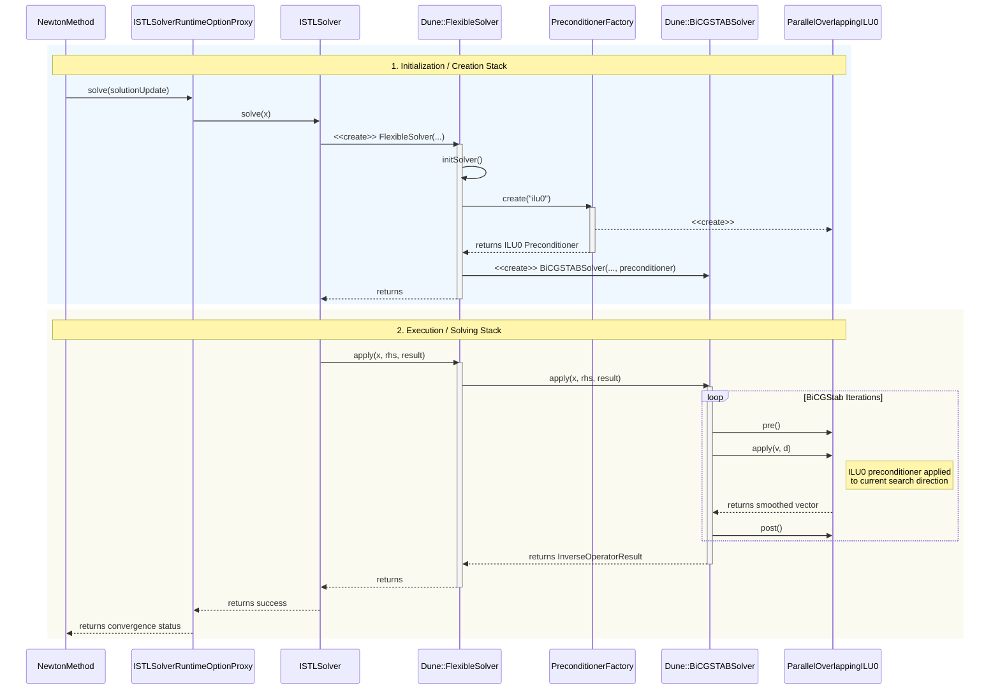
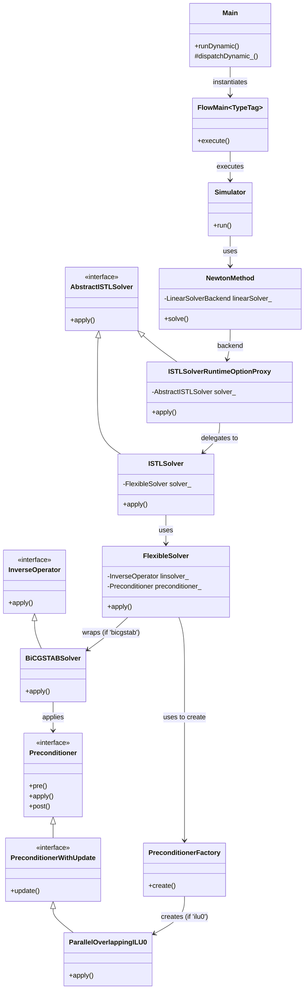

# OPM Flow Execution Flow: BiCGStab Solver with ILU0 Preconditioner

This document details the execution flow and class hierarchy for the `flow` executable in the `opm-simulators` repository when running a simulation using the BiCGStab linear solver with an ILU0 preconditioner.

## 1. Execution Flow Description

The execution of a simulation in OPM Flow follows a top-down approach, starting from the main binary entry point, dispatching to a specific physical model, stepping through time using a non-linear Newton solver, and finally solving the resulting linear systems.

### Initialization and Dispatching
1. **Entry Point (`flow/flow.cpp`)**: The executable begins in `main()`, which instantiates `Opm::Main` and calls its `runDynamic()` method.
2. **Model Selection (`Main::runDynamic()` & `Main::dispatchDynamic_()`)**: `Opm::Main` reads the Eclipse deck file (e.g., `.DATA` file) to initialize the simulation properties and configuration. It evaluates the physical model requirements (e.g., black-oil, water-only, thermal, micp, polymer) based on the active phases and options. It then dispatches execution to the corresponding runner, such as `runBlackOil()`.
3. **Simulator Instantiation (`flowBlackoilTpfaMain`)**: Depending on specific mechanics like TPFA (Two-Point Flux Approximation) or TPSA, a specific execution function is called (e.g., `flowBlackoilTpfaMain`). This function creates an instance of `Opm::FlowMain<TypeTag>` (where `TypeTag` provides compile-time property bindings) and triggers `execute()`.

### Simulation Loop and Non-Linear Solver
4. **Time Stepping (`Opm::Simulator::run`)**: `FlowMain` sets up the `Opm::Simulator` and enters the main time-stepping loop. For each time step, it calls a `step()` method.
5. **Newton Iterations (`Opm::NewtonMethod`)**: To resolve the non-linear equations for the current time step, the simulator employs a Newton-Raphson method (typically via `Opm::NewtonMethod`). In each Newton iteration:
   - The Jacobian matrix (`J`) and the residual vector (`r`) are computed.
   - The method requests a solution to the linearized system `J * x = r` by calling the `solve()` method on its `LinearSolverBackend`.

### Exact Call Stack: Solver Creation (Initialization)
When the linear solver is invoked for the first time (or if the matrix structure changes), the internal solver objects must be instantiated:
1. `Opm::ISTLSolver::solve(x)` is called. Before solving, it ensures the solver is set up.
2. It delegates setup to `Opm::detail::FlexibleSolverInfo::create(...)`.
3. `create(...)` constructs a `Dune::FlexibleSolver`, which acts as a bridge to DUNE ISTL.
4. The `Dune::FlexibleSolver` constructor calls its internal `initSolver(...)`.
5. `initSolver(...)` reads the `preconditioner` property (e.g., `"ilu0"`) and calls `Opm::PreconditionerFactory::create(...)`.
6. The factory instantiates the requested preconditioner, `Opm::ParallelOverlappingILU0`.
7. `initSolver(...)` then reads the `solver` property (e.g., `"bicgstab"`) and instantiates `Dune::BiCGSTABSolver`, passing it the newly created ILU0 preconditioner.

### Exact Call Stack: Execution (Solving)
Once the solver is instantiated, the iterative solve process happens in this stack:
1. `Opm::NewtonMethod::solve(solutionUpdate)`
2. `Opm::ISTLSolverRuntimeOptionProxy::solve(x)` (The backend wrapper)
3. `Opm::ISTLSolver::solve(x)`
4. `Dune::FlexibleSolver::apply(x, rhs, result)`
5. `Dune::BiCGSTABSolver::apply(x, rhs, result)`
6. Inside `BiCGSTABSolver::apply(...)`, it iterates to reduce the residual. During these iterations, it repeatedly calls the preconditioner's `apply()` method:
7. `Opm::ParallelOverlappingILU0::apply(...)` (Applies the ILU0 preconditioning steps to the vector).

---

## 2. Diagram: Exact Call Stacks (Creation and Execution)

---

## 3. Class Hierarchy

The following represents the hierarchical relationships (inheritance and aggregation) of the classes involved in the linear solver pipeline.

