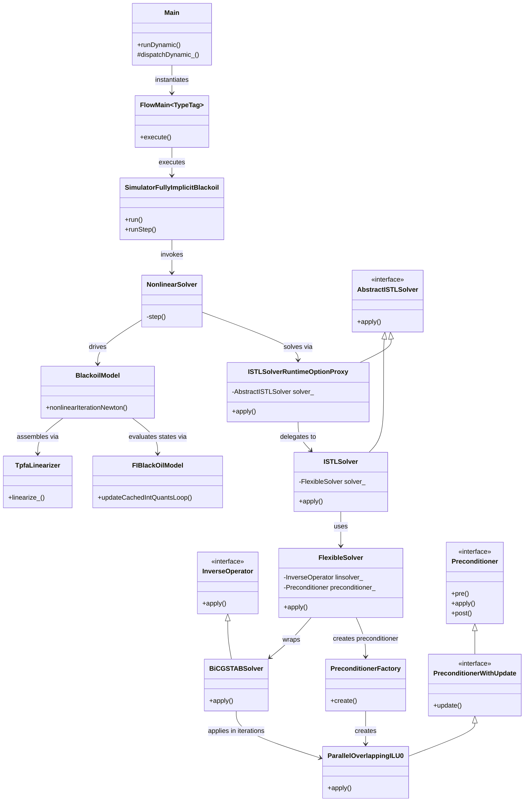

# OPM Flow Execution Flow: BiCGStab Solver with ILU0 Preconditioner & OpenMP Parallelism

This document details the end-to-end execution flow, OpenMP parallel regions, class hierarchy, and logged callstack transitions for the `flow` executable in `opm-simulators` when running with:
- **Linear Solver:** BiCGStab (`--linear-solver=ilu0`, `--use-gmres=false`)
- **Preconditioner:** ILU0 (`Opm::ParallelOverlappingILU0`)
- **Multithreading:** OpenMP (`--threads-per-process=4`)
- **MPI Processes:** 1 (`-np 1`)
- **Case Deck:** `SPE1CASE1.DATA`
- **Verified Log:** `my_callstack.log` (generated with `--enable-solver-callstack-log=true`)

---

## 1. Execution Flow Overview & OpenMP Concurrency Model

In OPM Flow, execution coordinates a multi-level loop hierarchy:
1. **Simulation Level:** Program initialization, reading Eclipse deck, setting up grid and static rock properties.
2. **Time-Stepping Loop (`SimulatorFullyImplicitBlackoil::run`):** Manages discrete simulation time steps according to schedule and adaptive time-stepping heuristics.
3. **Non-Linear Newton-Raphson Loop (`NonlinearSolver::step`):** Linearizes non-linear partial differential equations for multiphase fluid flow until convergence.
4. **Linear Solver Loop (`BiCGSTABSolver::apply`):** Solves the sparse block linear system $J \cdot x = r$ iteratively, evaluating the ILU0 preconditioner on each iteration.

### Concurrency Model: Master Thread vs. OpenMP Thread Pool
When running with `--threads-per-process=4`:
- **Serial / Control Flow (Thread 0 / Master):** Orchestrates simulation dispatch, time-step progression, convergence tests, and solver iteration state transitions.
- **Fork-Join OpenMP Multithreading (Threads 0-3):** Accelerates computationally intensive data-parallel kernels over grid cells and faces via `#pragma omp parallel for` or OpenMP parallel blocks.

---

## 2. Executable Flow Diagram Counting OpenMP Multithreading

The diagram below maps the complete execution flow, highlighting where execution is single-threaded (Master Thread) versus where it forks into 4 OpenMP worker threads.

```mermaid
flowchart TD
    classDef serial fill:#e1f5fe,stroke:#0288d1,stroke-width:2px,color:#01579b;
    classDef ompRegion fill:#e8f5e9,stroke:#2e7d32,stroke-width:2px,stroke-dasharray: 5 5,color:#1b5e20;
    classDef ompKernel fill:#c8e6c9,stroke:#388e3c,stroke-width:2px,color:#1b5e20;
    classDef solver fill:#fff3e0,stroke:#f57c00,stroke-width:2px,color:#e65100;

    %% 1. Initialization
    subgraph INIT["1. Initialization Phase (Single-Threaded Master)"]
        direction TB
        A["main(argc, argv)<br><i>flow/flow.cpp</i>"]:::serial
        B["Opm::Main::runDynamic()<br><i>Main.hpp</i>"]:::serial
        C["Opm::Main::dispatchDynamic_()<br><i>MainDispatchDynamic.cpp</i>"]:::serial
        D["Opm::Main::runBlackOil()<br><i>MainDispatchDynamic.cpp</i>"]:::serial
        E["Opm::FlowMain::execute()<br><i>FlowMain.hpp</i>"]:::serial
        A --> B --> C --> D --> E
    end

    %% OpenMP Static Grid Setup
    subgraph OMP_INIT["OpenMP Stage 1: Static Grid & Initial Properties (4 Threads)"]
        direction TB
        E1["Fork OpenMP Pool<br>#pragma omp parallel for"]:::ompRegion
        K1["Opm::Transmissibility::update()<br><i>Transmissibility_impl.hpp</i><br>• Compute face transmissibilities across all grid faces"]:::ompKernel
        K2["Opm::FIBlackOilModel::updateCachedIntQuantsLoop()<br><i>FIBlackoilModel.hpp</i><br>• Initial cell-wise fluid states & intensive properties"]:::ompKernel
        K3["Opm::EclWriter::writeInitialFIPReport()<br><i>EclWriter.hpp</i><br>• Compute initial fluids-in-place (FIP) over cells"]:::ompKernel
        E1 --> K1 --> K2 --> K3
    end
    E --> E1

    %% 2. Time-Stepping Loop
    subgraph TIMESTEP["2. Simulation Time-Stepping Loop (Master Control)"]
        direction TB
        F["Opm::SimulatorFullyImplicitBlackoil::run()<br><i>SimulatorFullyImplicitBlackoil.hpp</i>"]:::serial
        G["Opm::SimulatorFullyImplicitBlackoil::runStep()<br><i>SimulatorFullyImplicitBlackoil.hpp</i>"]:::serial
        H["Opm::NonlinearSolver::step()<br><i>NonlinearSolver.hpp</i>"]:::serial
        F --> G --> H
    end
    K3 --> F

    %% 3. Non-Linear Newton Loop
    subgraph NEWTON_LOOP["3. Newton-Raphson Non-Linear Iteration Loop"]
        direction TB
        subgraph OMP_THERMO["OpenMP Stage 2: Thermodynamic Property Evaluation (4 Threads)"]
            T1["Fork OpenMP Pool<br>#pragma omp parallel for"]:::ompRegion
            T2["Opm::FIBlackOilModel::updateCachedIntQuantsLoop()<br><i>FIBlackoilModel.hpp</i><br>• Intensive quantities for all active cells<br>• Pressures, saturations, viscosities, densities, FVF"]:::ompKernel
            T1 --> T2
        end

        N1["Opm::BlackoilModel::nonlinearIterationNewton()<br><i>BlackoilModel_impl.hpp</i>"]:::serial

        subgraph OMP_ASSEMBLY["OpenMP Stage 3: Jacobian Matrix & Residual Assembly (4 Threads)"]
            A1["Fork OpenMP Pool<br>#pragma omp parallel"]:::ompRegion
            A2["Opm::TpfaLinearizer::linearize_()<br><i>tpfalinearizer.hh</i><br>• Element/face TPFA residual calculation r<br>• Sparse Jacobian matrix assembly J"]:::ompKernel
            A1 --> A2
        end

        H --> T1
        T2 --> N1
        N1 --> A1
    end

    %% 4. Linear Solver Phase
    subgraph LINEAR_SOLVER["4. Linear Solver Phase: BiCGStab + ILU0 Preconditioner"]
        direction TB
        L1["Opm::ISTLSolverRuntimeOptionProxy::solve()<br><i>ISTLSolverRuntimeOptionProxy.hpp</i>"]:::solver
        L2["Opm::ISTLSolver::solve()<br><i>ISTLSolver.hpp</i>"]:::solver
        L3["Dune::FlexibleSolver::apply()<br><i>FlexibleSolver_impl.hpp</i>"]:::solver
        L4["Dune::BiCGSTABSolver::apply()<br><i>BiCGStab Outer Loop</i>"]:::solver

        L1 --> L2 --> L3 --> L4

        subgraph KRYLOV_LOOP["BiCGStab Krylov Iteration Loop"]
            direction TB
            P1["Preconditioner Solve 1 (p-vector)<br>Dune::BiCGSTABSolver::apply"]:::solver
            I1["Opm::ParallelOverlappingILU0::apply()<br>• Forward & backward triangular solve W * y = p"]:::solver
            M1["SpMV Matrix-Vector Product: v = J * y<br>Vector inner products: &alpha; = (r, r&#770;) / (v, r&#770;)"]:::solver
            P2["Preconditioner Solve 2 (r-vector)<br>Dune::BiCGSTABSolver::apply"]:::solver
            I2["Opm::ParallelOverlappingILU0::apply()<br>• Forward & backward triangular solve W * z = s"]:::solver
            M2["SpMV Matrix-Vector Product: t = J * z<br>Inner product &omega;, update x = x + &alpha;y + &omega;z"]:::solver

            P1 --> I1 --> M1 --> P2 --> I2 --> M2
        end
        L4 --> P1
    end
    A2 --> L1

    %% Post-processing & Output
    subgraph OMP_OUTPUT["5. OpenMP Stage 4: Output Preparation (4 Threads)"]
        direction TB
        O1["Fork OpenMP Pool<br>#pragma omp parallel for"]:::ompRegion
        O2["Opm::EclWriter::prepareLocalCellData()<br><i>EclWriter.hpp</i><br>• Extract cell pressure, saturation, rates for Eclipse output"]:::ompKernel
        O1 --> O2
    end

    %% Transitions & Loops
    M2 -->|Linear System Solved| UPD["Update Solution Variables<br>& Check Newton Convergence"]:::serial
    UPD -->|Newton Not Converged| T1
    UPD -->|Newton Converged| O1
    O2 -->|Step Finished| G
    G -->|All Time Steps Finished| DONE(["Simulation Finished Successfully"]):::serial
```

---

## 3. Verified Call Sequence Traced

```mermaid
flowchart TD
    M["[Execution Flow CallStack]<br>int main() - flow/flow.cpp"] --> RD["[Execution Flow CallStack]<br>Opm::Main::runDynamic()"]
    RD --> DD["[Execution Flow CallStack]<br>Opm::Main::dispatchDynamic_()"]
    DD --> RB["[Execution Flow CallStack]<br>Opm::Main::runBlackOil()"]
    RB --> FM["[Execution Flow CallStack]<br>Opm::FlowMain::execute()"]

    %% Initialization Branch
    FM --> TU["[Execution Flow CallStack]<br>Opm::Transmissibility::update()"]
    TU --> IQ1["[Execution Flow CallStack]<br>Opm::FIBlackOilModel::invalidateAndUpdateIntensiveQuantities()"]
    IQ1 --> IQ2["[Execution Flow CallStack]<br>Opm::FIBlackOilModel::updateCachedIntQuantsLoop()"]
    IQ2 --> FIP["[Execution Flow CallStack]<br>Opm::EclWriter::writeInitialFIPReport()"]

    %% Main Simulation Loop
    FIP --> SR["[Execution Flow CallStack]<br>Opm::SimulatorFullyImplicitBlackoil::run()"]
    SR --> SRS["[Execution Flow CallStack]<br>Opm::SimulatorFullyImplicitBlackoil::runStep()"]
    SRS --> NS["[Execution Flow CallStack]<br>Opm::NonlinearSolver::step()"]

    %% Newton Loop
    subgraph NEWTON["Newton-Raphson Iteration"]
        direction TB
        NS --> NIQ["Opm::FIBlackOilModel::invalidateAndUpdateIntensiveQuantities()"]
        NIQ --> NQL["Opm::FIBlackOilModel::updateCachedIntQuantsLoop()"]
        NQL --> NWI["Opm::BlackoilModel::nonlinearIterationNewton()"]
        NWI --> LIN["Opm::TpfaLinearizer::linearize_()"]
    end

    %% Linear Solver Transition
    LIN --> PROXY["[Execution Flow CallStack]<br>Opm::ISTLSolverRuntimeOptionProxy::solve()"]
    PROXY --> ISTL["[Execution Flow CallStack]<br>Opm::ISTLSolver::solve()"]
    ISTL --> FLEX["[Execution Flow CallStack]<br>Dune::FlexibleSolver::apply()"]
    FLEX --> BCENTER["[BiCGStab CallStack]<br>Dune::BiCGSTABSolver::apply (Enter)"]

    %% BiCGStab / ILU0 Preconditioner Loop
    subgraph SOLVER_LOOP["BiCGStab Iteration & ILU0 Preconditioner Application"]
        direction TB
        BCENTER --> BCP["[BiCGStab CallStack]<br>BiCGSTABSolver::apply: Applying preconditioner (y = W^-1 * p)"]
        BCP --> ILU1["[ILU0 CallStack]<br>Opm::ParallelOverlappingILU0::apply"]
        ILU1 --> BCR["[BiCGStab CallStack]<br>BiCGSTABSolver::apply: Applying preconditioner (y = W^-1 * r)"]
        BCR --> ILU2["[ILU0 CallStack]<br>Opm::ParallelOverlappingILU0::apply"]
    end

    %% Convergence and Output
    ILU2 -.->|Converged| OUT["[Execution Flow CallStack]<br>Opm::EclWriter::prepareLocalCellData()"]
    OUT --> SRS
```

---

## 4. OpenMP Multithreading Stages Breakdown

The run with `--threads-per-process=4` leverages OpenMP parallel regions in five key stages of the simulation:

| Stage | Class & Function | Source File | OpenMP Construct & Parallel Scope | Frequency in Log |
| :--- | :--- | :--- | :--- | :--- |
| **Stage 1: Grid Transmissibility** | `Opm::Transmissibility::update` | `opm/simulators/flow/Transmissibility_impl.hpp` | `#pragma omp parallel for` Parallelizes loop over all interior and boundary grid faces to compute geometric and transmissibility factors. | Initial grid setup |
| **Stage 2: Fluid State Evaluation** | `Opm::FIBlackOilModel::updateCachedIntQuantsLoop` | `opm/simulators/flow/FIBlackoilModel.hpp` | `#pragma omp parallel for` Parallelizes evaluation of intensive thermodynamic state quantities (pressures, phase saturations, viscosities, densities, formation volume factors) across active reservoir cells. | 1,050 calls (every Newton step) |
| **Stage 3: TPFA Linearization & Assembly** | `Opm::TpfaLinearizer::linearize_` | `opm/models/discretization/common/tpfalinearizer.hh` | `#pragma omp parallel` Parallel element-by-element and face-by-face assembly of residual vector $r$ and sparse Jacobian matrix $J$. | 1,043 calls (every Newton step) |
| **Stage 4: Output Preparation** | `Opm::EclWriter::prepareLocalCellData` & `writeInitialFIPReport` | `opm/simulators/flow/EclWriter.hpp` | `#pragma omp parallel for` Parallelizes loop extracting local cell solutions into Eclipse restart/summary buffers. | 246 calls (reporting steps) |
| **Stage 5: Krylov Iterative Linear Algebra** | `Dune::BiCGSTABSolver::apply` | `dune/istl/solvers.hh` & `FlexibleSolver_impl.hpp` | Parallel vector arithmetic, dot products, and triangular sweeps per domain partition. | 4,482 linear solves |

---

## 5. Class Hierarchy

