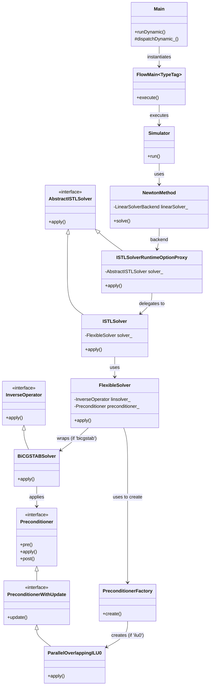

# OPM Flow Execution Flow: BiCGStab Solver with ILU0 Preconditioner

This document details the execution flow and class hierarchy for the `flow` executable in the `opm-simulators` repository when running a simulation using the BiCGStab linear solver with an ILU0 preconditioner.

## 1. Execution Flow Description

The execution of a simulation in OPM Flow follows a top-down approach, starting from the main binary entry point, dispatching to a specific physical model, stepping through time using a non-linear Newton solver, and finally solving the resulting linear systems.

### Initialization and Dispatching
1. **Entry Point (`flow/flow.cpp`)**: The executable begins in `main()`, which instantiates `Opm::Main` and calls its `runDynamic()` method.
2. **Model Selection (`Main::runDynamic()` & `Main::dispatchDynamic_()`)**: `Opm::Main` reads the Eclipse deck file (e.g., `.DATA` file) to initialize the simulation properties and configuration. It evaluates the physical model requirements (e.g., black-oil, water-only, thermal, micp, polymer) based on the active phases and options. It then dispatches execution to the corresponding runner, such as `runBlackOil()`.
3. **Simulator Instantiation (`flowBlackoilTpfaMain`)**: Depending on specific mechanics like TPFA (Two-Point Flux Approximation) or TPSA, a specific execution function is called (e.g., `flowBlackoilTpfaMain`). This function creates an instance of `Opm::FlowMain<TypeTag>` (where `TypeTag` provides compile-time property bindings) and triggers `execute()`.

### Simulation Loop and Non-Linear Solver
4. **Time Stepping (`Opm::Simulator::run`)**: `FlowMain` sets up the `Opm::Simulator` and enters the main time-stepping loop. For each time step, it calls a `step()` method.
5. **Newton Iterations (`Opm::NewtonMethod`)**: To resolve the non-linear equations for the current time step, the simulator employs a Newton-Raphson method (typically via `Opm::NewtonMethod`). In each Newton iteration:
   - The Jacobian matrix (`J`) and the residual vector (`r`) are computed.
   - The method requests a solution to the linearized system `J * x = r` by calling the `solve()` method on its `LinearSolverBackend`.

### Linear Solver Setup and Execution
6. **Linear Solver Backend (`Opm::ISTLSolverRuntimeOptionProxy` / `Opm::ISTLSolver`)**: The `LinearSolverBackend` property resolves to `ISTLSolverRuntimeOptionProxy`. This proxy reads runtime parameters (such as `--linear-solver=ilu0` or `--solver=bicgstab --preconditioner.type=ilu0`) and initializes the actual `Opm::ISTLSolver`.
7. **Flexible Solver Construction (`Dune::FlexibleSolver`)**: `ISTLSolver` instantiates a `Dune::FlexibleSolver` which acts as a bridge to DUNE's Iterative Solver Template Library (ISTL).
8. **Solver and Preconditioner Instantiation**:
   - **Solver**: Based on the string `"bicgstab"`, `FlexibleSolver` creates a `Dune::BiCGSTABSolver<VectorType>`.
   - **Preconditioner**: `FlexibleSolver` uses `Opm::PreconditionerFactory` to instantiate the preconditioner. Based on the string `"ilu0"`, it creates an `Opm::ParallelOverlappingILU0` (for MPI parallel runs) or an equivalent sequential/GPU ILU0 preconditioner depending on the hardware backend.
9. **Solving the System**: The `FlexibleSolver` executes the `BiCGSTABSolver`, which iteratively approximates the solution vector `x` while applying the `ILU0` preconditioner to accelerate convergence. Once solved, the Newton method updates the state variables and checks for non-linear convergence.

---

## 2. Diagram: Execution Flow and Component Relationships

```mermaid
flowchart TD
    %% Program Entry
    A[main() <br> <i>flow/flow.cpp</i>] --> B[Opm::Main::runDynamic <br> <i>opm/simulators/flow/Main.hpp</i>]
    B --> C[Opm::Main::dispatchDynamic_ <br> <i>MainDispatchDynamic.cpp</i>]

    %% Model Dispatch
    C -->|e.g., Black-oil| D[Opm::Main::runBlackOil]
    D --> E[flowBlackoilTpfaMain]
    E --> F[Opm::FlowMain<TypeTag>::execute <br> <i>FlowMain.hpp</i>]

    %% Simulation Loop
    F --> G[Opm::Simulator::run <br> <i>simulator.hh</i>]
    G -->|Time step loop| H[Opm::NewtonMethod::solve <br> <i>newtonmethod.hh</i>]

    %% Non-Linear to Linear Transition
    H -->|Build J, r| I[LinearSolverBackend::solve <br> <i>ISTLSolverRuntimeOptionProxy</i>]

    %% Linear Solver Subsystem
    I --> J[Opm::ISTLSolver::apply <br> <i>ISTLSolver.cpp</i>]
    J --> K[Dune::FlexibleSolver <br> <i>FlexibleSolver_impl.hpp</i>]

    %% DUNE ISTL Components
    K -->|solver='bicgstab'| L[Dune::BiCGSTABSolver]
    K -->|precond='ilu0'| M[Opm::PreconditionerFactory]
    M --> N[Opm::ParallelOverlappingILU0]

    L -.->|Applies Preconditioner| N
```

---

## 3. Class Hierarchy

The following represents the hierarchical relationships (inheritance and aggregation) of the classes involved in the linear solver pipeline.


