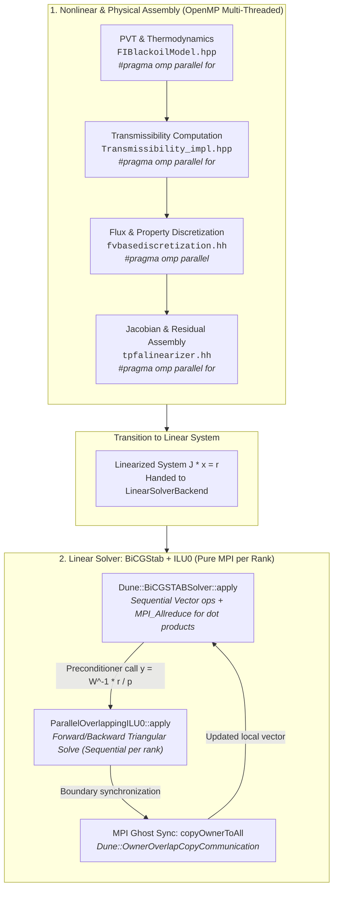

# Parallel Execution Architecture: OpenMP vs MPI in OPM Flow (BiCGStab + ILU0)

This document provides a comprehensive breakdown of the hybrid parallelism architecture in the OPM Flow simulator, specifically focusing on how OpenMP (shared-memory multithreading) and MPI (distributed-memory message passing) are utilized in a simulation run using the **BiCGStab** linear solver with an **ILU0** preconditioner.

---

## 1. Executive Summary

OPM Flow utilizes a two-tier hybrid parallel architecture:

1. **Nonlinear & Physical Assembly (OpenMP + MPI)**:
   * Multi-threading via OpenMP is extensively used for the embarrassingly parallel components of the simulation step, including PVT thermodynamic property evaluations, transmissibility calculations, and Jacobian matrix/residual assembly.
   * Work is split over threads per MPI process using `#pragma omp parallel for` constructs.

2. **Linear Solver Phase (Pure MPI per rank)**:
   * Inside the linear solver (`BiCGStab`) and the preconditioner (`ParallelOverlappingILU0`), computation within each MPI process is **purely sequential**.
   * Parallelism is achieved strictly via **MPI Domain Decomposition**: each rank performs local operations on its assigned cells and communicates boundary information with neighbor ranks.

---

## 2. Architecture & Execution Flow Diagram

---

## 3. Why BiCGStab and ILU0 are Sequential per MPI Process

### Loop-Carried Dependencies in Triangular Solves
The core application of the ILU0 preconditioner consists of two triangular solves:
1. **Forward Substitution** ($L y = d$):
   $$y_i = d_i - \sum_{j < i} L_{ij} y_j$$
2. **Backward Substitution** ($U x = y$):
   $$x_i = U_{ii}^{-1} \left( y_i - \sum_{j > i} U_{ij} x_j \right)$$

Because unknown $i$ depends directly on previously computed unknowns $j < i$ (in forward solve) or $j > i$ (in backward solve), these loops contain strict data dependencies across iterations. Standard OpenMP loop pragmas cannot be applied without altering the ordering (e.g., multi-coloring / red-black ordering).

### Domain Decomposition via MPI
Instead of fine-grained thread parallelism in the triangular solve, DUNE-ISTL and OPM employ **overlapping Schwarz domain decomposition**:
* The grid is partitioned across MPI processes using Zoltan or METIS.
* Each MPI rank solves the ILU0 triangular system on its own sub-matrix (composed of its interior and overlap cells).
* Boundary degrees of freedom are reconciled across processes using `Dune::OwnerOverlapCopyCommunication::copyOwnerToAll`.

---

## 4. Code Cross-Reference Table

| Phase | Component / File | Parallel Technology | Details |
| :--- | :--- | :--- | :--- |
| **Setup** | `ThreadManager.cpp` | OpenMP | Calls `omp_set_num_threads()` to configure thread pool. |
| **Grid** | `GenericCpGridVanguard.cpp` | MPI | Calls Zoltan graph partitioner to distribute grid cells. |
| **Assembly** | `FIBlackoilModel.hpp` | OpenMP | `#pragma omp parallel for` over cells for PVT state evaluation. |
| **Assembly** | `Transmissibility_impl.hpp` | OpenMP | `#pragma omp parallel for` across cell faces for transmissibilities. |
| **Assembly** | `fvbasediscretization.hh` | OpenMP | `#pragma omp parallel` for fluid mobilities and fluxes. |
| **Assembly** | `tpfalinearizer.hh` | OpenMP | `#pragma omp parallel for` for assembling the Jacobian and residual. |
| **Solver** | `solvers.hh` (DUNE-ISTL) | MPI (No OpenMP) | BiCGStab algorithm; uses `MPI_Allreduce` for dot products. |
| **Preconditioner** | `ParallelOverlappingILU0_impl.hpp` | MPI (No OpenMP) | Sequential triangular solves on each rank + MPI overlap sync. |
| **Output** | `EclWriter.hpp` | OpenMP | `#pragma omp parallel for` formatting output tables and restarts. |
